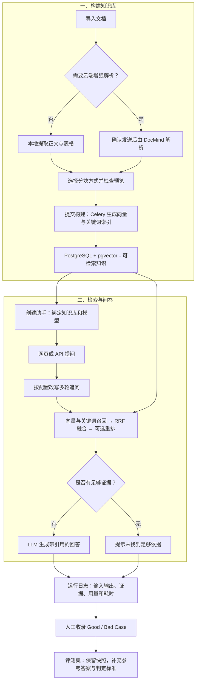

# 知境 Zhijing RAG

知境是一个可自行部署的知识库问答中台。它把文档导入、解析与分块预览、混合检索、带引用的问答，以及运行日志和评测集放在同一套界面里。适合搭建产品手册、企业制度、客服规则等资料的问答助手，也适合调试一条完整的 RAG 链路。

## 功能

| 模块 | 能做什么 |
| --- | --- |
| 知识库 | 导入 PDF、Word、Excel、Markdown、CSV 和图片；检查解析结果、分块与来源位置；异步构建索引，支持检索测试。 |
| 文档解析 | 普通文本可在服务器本地解析；扫描件、图片与复杂版式可通过阿里云 DocMind 处理，发送文件前需确认。 |
| 模型与检索 | 配置 LLM、Embedding 和可选 Rerank；使用向量和关键词混合召回、RRF 融合和可选重排。 |
| 助手 | 绑定知识库与模型，提供流式对话和引用；检索证据不足时提示无法回答。支持 OpenAI 兼容的 `/v1/chat/completions`。 |
| 运行日志 | 查看查询、回答、引用、已有执行步骤、模型用量、耗时和错误。 |
| 评测集 | 从日志手动收录 Good / Bad Case，保留独立运行快照；补充参考答案和判定标准，支持筛选、归档与删除。 |

## 工作流程



## 快速开始

```bash
git clone https://github.com/xma28016-gif/zhijing-rag.git
cd zhijing-rag
```

### Docker Compose

安装 Docker 和 Compose v2，在新克隆的目录中运行：

```bash
sh scripts/bootstrap-env.sh
docker compose up --build -d
docker compose ps
```

打开 <http://localhost:8080>。API 文档在 <http://localhost:8080/api/docs>。初始化脚本会生成本地凭据，不会覆盖已有 `.env`。可用 `docker compose down` 停止服务并保留数据卷。

### macOS 本机运行

安装 Python 3.12、Node.js 22 或更新版本、pnpm 及 Xcode Command Line Tools。首次准备依赖时，脚本会在项目目录安装 PostgreSQL、pgvector、Redis 和应用依赖：

```bash
bash scripts/setup-native.sh
backend/.venv/bin/python scripts/local.py start
```

打开 <http://localhost:3000>。可用 `backend/.venv/bin/python scripts/local.py status` 检查服务，或将 `status` 改为 `stop` 停止。也可以双击 `启动中台.command` 或 `停止中台.command`。

### 跑通一次问答

1. 左下角切换为「管理员」，在「模型服务」配置服务商，添加并验证 **Embedding** 和 **LLM**。Rerank 可选。
2. 在「知识库」建库，导入一份 Markdown 或 PDF，检查分块预览后提交构建。扫描件或图片需要在「系统设置 → 云端 OCR」另配 DocMind AccessKey。
3. 创建助手，绑定构建完成的知识库和 LLM 并发布。助手名称可用中文；调用别名可填 `product-assistant`。
4. 在「在线对话」提问并打开引用；在「运行日志」查看该次请求，或将它收录到「评测集」。

> 当前管理界面是面向本机或可信测试环境的免登录版本。体验角色不提供真实身份认证或数据隔离；部署到公网前应先接入身份验证和授权。`.env`、本机 `.data/`、上传文件、日志和备份均应保存在本地。

## 技术栈与目录

| 路径 | 内容 |
| --- | --- |
| [`app/`](app/)、[`components/`](components/) | Next.js、React、TypeScript 管理界面和对话。 |
| [`backend/app/`](backend/app/) | FastAPI 接口、LangChain Core 问答链路、文档处理、模型适配和 Celery 任务。 |
| [`backend/alembic/`](backend/alembic/) | PostgreSQL、pgvector 的数据库迁移。 |
| [`infra/`](infra/)、[`scripts/`](scripts/) | Nginx 代理、本机启停、部署和备份脚本。 |
| [`docs/`](docs/) | 验收手册、检索查询和评测样例。 |

文件存储支持本机文件系统与 MinIO。当前评测集面向人工收录和标注；运行日志覆盖现有 RAG 步骤。项目暂不提供通用 Agent 编排、自动评分或独立计费系统。

## 开发与测试

```bash
pnpm install --frozen-lockfile
pnpm typecheck
pnpm build

cd backend
python3.12 -m venv .venv
.venv/bin/python -m pip install -r requirements.lock
.venv/bin/python -m pip install -e '.[dev]'
.venv/bin/python -m pytest -q
```

后端 OpenAPI 文件位于 [`backend/openapi.json`](backend/openapi.json)。接口变动后可在项目根目录运行 `pnpm api:generate` 更新前端类型。质量与容量测试见[验收手册](docs/acceptance-runbook.md)。

## 许可证

项目源码采用 [MIT 许可证](LICENSE)。
